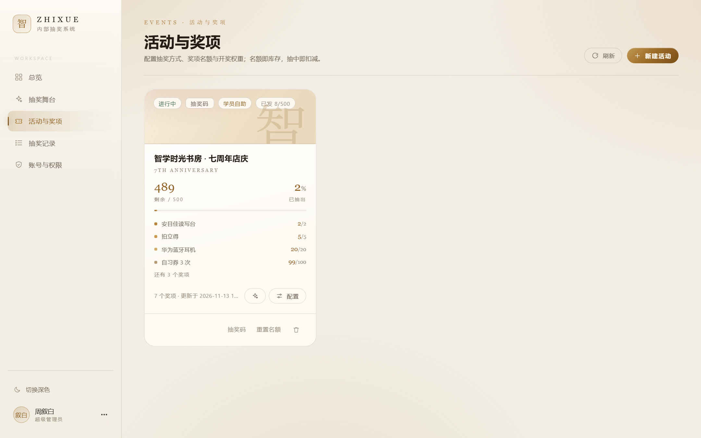
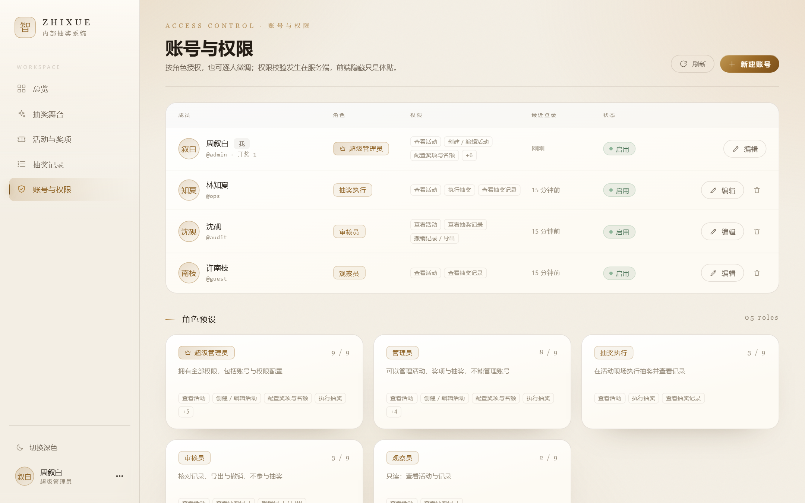
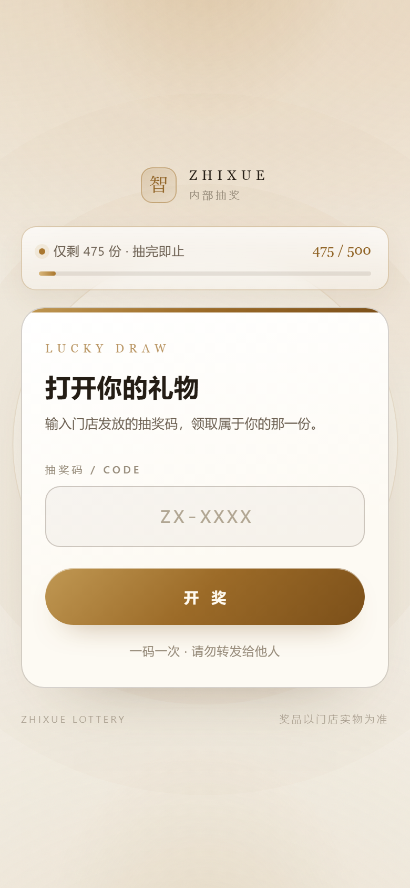
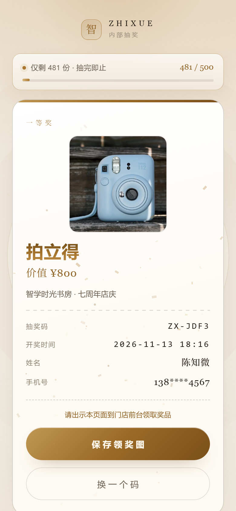
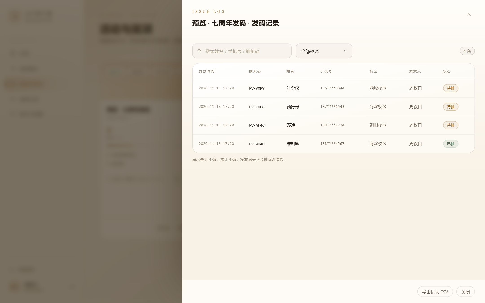

# 智学内部抽奖系统

一个可直接运行的抽奖系统：账号登录、角色与逐项权限配置、三种抽奖方式（**名单抽奖 / 概率抽奖 / 抽奖码**），
以及一整套为现场大屏准备的开奖舞台。

零第三方依赖——只有 Node 内置模块 + 原生前端，`node server/index.js` 即可启动。

**配色**：默认「暖白纸感 + 焦糖金」浅色主题，侧边栏底部可一键切到深色版本，偏好记在本地。


| 总览 | 抽奖舞台 |
| --- | --- |
|  |  |

| 活动与奖项（含样品图） | 账号与权限 |
| --- | --- |
|  |  |

| 学员自助 · 输码 | 开奖结果 |
| --- | --- |
|  |  |

| 保存的领奖图（JPG） | 发码记录 |
| --- | --- |
|  |  |

---

## 快速开始

```bash
# 克隆后进到项目目录
cd aurum-lottery
node server/index.js
```

打开 <http://127.0.0.1:5180>，用演示账号登录：

| 账号 | 密码 | 角色 | 能做什么 |
| --- | --- | --- | --- |
| `admin` | `admin123` | 超级管理员 | 全部权限（活动、奖项、抽奖、记录、账号与权限） |
| `ops` | `ops123` | 抽奖执行 | 现场抽奖 + 查看记录 |
| `audit` | `audit123` | 审核员 | 查看/撤销/导出记录，不能抽奖 |
| `guest` | `guest123` | 观察员 | 只读：活动与记录 |

> 可用环境变量改端口：`PORT=8080 node server/index.js`。
> 首次启动会自动生成 `data/db.json` 演示数据（3 场活动、40+ 条开奖记录、40 枚抽奖码）。

---

## 功能

### 1. 账号与权限

- 密码使用 **scrypt + 随机盐** 存储，登录发放 HttpOnly / SameSite=Lax 会话 Cookie（12 小时），登录失败按账号限流。
- 5 个角色预设：超级管理员、管理员、抽奖执行、审核员、观察员。
- 9 项可独立勾选的权限：

  | 分组 | 权限 |
  | --- | --- |
  | 活动 | 查看活动 / 创建编辑活动 / 配置奖项与名额 |
  | 抽奖 | 执行抽奖 / 查看记录 / 撤销记录与导出 / 重置名额 |
  | 账号 | 查看账号 / 账号与权限管理 |

- 角色给的是「预设」，勾选框按人覆盖——改角色会重置勾选，之后可继续微调。
- 支持停用账号（立即踢下线）、重置密码、删除账号；不能修改/删除自己，超级管理员始终拥有全部权限。
- **所有权限校验都在服务端**：前端只是隐藏入口，越权请求一律 403。

### 2. 三种抽奖方式

| 方式 | 规则 |
| --- | --- |
| **名单抽奖**（核心） | 操作者先选中某个奖项，每抽一次该奖项 `remaining` 减 1，减到 0 显示「已抽完」并禁止再抽。名额是唯一真源，多端并发也不会超发。 |
| **概率抽奖** | 按奖项权重加权随机，可设置「谢谢参与」权重；未中奖不扣名额，中奖照常扣减对应名额。 |
| **抽奖码** | 一码一次：输入 `ZX-XXXX` 开奖，码被使用后作废，必中剩余奖项；支持批量生成、复制、重置。 |

所有方式都支持：可选填参与者姓名、按活动设置「每人限抽次数」（0 = 不限）、名额实时同步到记录与统计。

**复制活动**：活动卡片右下角点「复制」，会把奖项（名称、等级、名额、权重、价值、样品图）和全部配置（抽奖方式、副标题、每人限抽、谢谢参与权重、学员自助开关）整份复制成一场新活动，名字自动加「（副本）」并进入**草稿**状态，同时打开编辑抽屉让你改名字。**抽奖码和开奖记录不会复制**，名额全部重置为满额——适合"照去年的场子再来一届"。

### 3. 开奖舞台

- **抽奖码模式下自动带出中奖人**：舞台输入已绑定的码开奖时，揭晓结果和右侧流水都会显示持码人姓名（如「一等奖 · 陈知微 · 剩余 1/2」），保存的获奖图也直接写上名字；散码（没绑定）则不显示这一行。
- **手动控制开奖节奏**：点「开始抽奖」后奖项名开始滚动，按钮变成红色的「停止」；再点一次（或按空格）才停止并揭晓结果。结果在停止那一刻才真正落库，滚多久由现场临时决定，适合配口播、倒数或吊胃口。
- 旋转光环 + 揭晓动画 + 礼花粒子 + 合成提示音（可静音）。
- 右侧奖项池实时显示剩余/总数与进度条，抽完自动置灰；本场开奖流水同步刷新（每 6 秒自动同步）。
- **大屏模式**：一键隐藏导航、放大舞台并进入全屏，适合投影。
- **明暗主题**：浅色为默认，点击侧边栏底部「切换深色」即时换肤；所有颜色都走 CSS 变量，深色档保留了原午夜黑方案。

### 4. 学员自助开奖（免登录）

活动开启「学员自助开奖」后，学员扫码打开 `/redeem`，输入抽奖码即可自己开奖，**不需要账号**：

- 页面顶部实时显示**剩余名额**：`仅剩 487 份 · 抽完即止` + 一条进度条（已抽掉的比例一目了然），每 8 秒自动刷新，开奖后立即更新，不用手动刷新。剩余不足 10% 时文案会变成醒目的暖红色。
- 一码一次：码用过即作废，重复提交会提示「已经抽过」；无效码只返回模糊提示，不暴露码库。
- **滚动揭晓动画**：提交后先转一圈光环、奖项名快速滚动（和舞台一致），约 1.6 秒后停在中奖奖项上再弹出结果，避免"秒出"显得太随意。
- 结果页会显示**开奖时间**，以及**姓名**和**手机号**（手机号中间四位打码，如 `138****4567`），前台兑奖时可直接核对；保存下来的领奖图、微信长按保存的页面也都带日期（`2026-11-13 18:08`）。
- 只对「抽奖码」方式 + 「进行中」+ 已开启自助的活动生效，草稿/暂停的活动取不到码。
- 每次开奖按同一套权重从剩余奖池里出奖，结果写入同一份记录（操作人记为「学员自助」）。
- 接口按 IP 限流（10 分钟 40 次），防止脚本撞码。
- 支持 `?code=ZX-XXXX` 预填（把个性化链接/二维码直接发给学员）。

支持批量生成码时指定**前缀**（如 `ZX`、`BJ01`），多场活动、多个校区的码互不重复。

**收费即发码（推荐用于边收边发）**：不用提前知道各校区收多少人。缴费现场在「抽奖码 → 收费即发码」里填学员姓名、**完整手机号**、校区，点一下就从空码池里按顺序取一枚发给他，界面上直接给出码、复制按钮和专属二维码。

**重复发放拦截**：同名同手机号直接拒绝，不可强制；只有**同名**（换了手机号）或只有**同手机号**（换了名字）时，会弹出「已有同名学员「张三」领过 ZX-XXXX，确定不是同一位学生吗？」，确认后才能重发。批量绑定名单时，名单里已发过的学员会被自动跳过。

**手机发码页**：`/m`（也可用 `/staff`）是给现场老师用的移动端页面，按手机单列布局做：登录 → 选活动 → 填姓名/手机号/校区 → 确认弹窗 → 出码并直接显示学员可扫的二维码。顶部显示剩余空码/已发出/已开奖，底部是最近发码记录，每 10 秒自动刷新；桌面端「抽奖码」抽屉里也有「手机发码页」入口。

**发码必确认**：任何一次发码都会先弹窗确认——单发时显示「姓名 / 手机号 / 校区 / 剩余空码」，批量绑定时显示「将绑定几位、名单预览」，点「确认发放 / 确认绑定」才真正落库，避免手滑点一下就发出去。

**老师账号批量开通**：可以把手机号直接当登录账号，初始密码设为手机号后 6 位，角色统一给「抽奖执行」。新建账号默认要求**首次登录必须改密码**——没改之前，除了「看自己 / 改密码 / 退出」和学员公开接口，其余接口一律返回 `403 password_change_required`；桌面端和手机发码页都会直接显示改密页，改完才进得去。管理员在「账号与权限」里能一眼看到谁还是「待改密码」，重置某个人的密码后也会自动重新要求改密。

**删除与恢复**：删除活动会连同开奖记录、抽奖码、发码记录一起删除，但服务端会先把整场快照写到 `data/trash/`（保留最近 30 份）。活动页右上角「回收站」可以查看这些备份并一键恢复——活动、奖项剩余名额、开奖记录都会原样回来。

**发码抽屉自动同步**：抽屉打开时每 6 秒刷新一次剩余空码、校区发放统计、码池状态和已绑定数，别的账号同时在发码也能看到；页面切到后台暂停，切回来立刻刷一次，关掉抽屉就停，不会空跑请求。表单里正在填的内容不会被刷新冲掉。

**校区预设**：在「配置活动 → 发码字段」里一行一个填好常用校区（本系统已按你发过的码自动预填 7 个），发码时的「校区」会变成**可搜索、只能选不能手写**的下拉框——输入"高"就筛出"高新区校区"，点一下才写入，手打的名字不会被接受，杜绝"海淀校区 / 海淀 / 海淀区"这种写法不一致。

**逐项必填**：姓名、手机号、校区各有独立的「必填」开关，默认姓名和手机号必填、校区选填。关掉某一项后，发码时就可以留空（例如只发码不登记姓名），服务端按活动配置校验，批量绑定名单同样生效。

**码池权限**：完整码池（每一枚码）只有管理员可见；「抽奖执行」及以下账号看不到未发放的码，只能通过发码入口现场领取、查看自己发过的记录和聚合数字（总数/已发/剩余/各校区），防止码被批量抄走。

**发码记录**：每一次发码（单个发、批量绑）都会落一条不可篡改的流水——时间、抽奖码、姓名、手机号、校区、发放人、状态（待抽/已抽/已解绑）。抽屉里点「查看发码记录」可按姓名/手机/码搜索、按校区筛选，并可导出 CSV。解绑不会抹掉流水。

**抽奖码名单导出**：抽屉底部「导出名单 CSV」导出全部码，列是 `抽奖码 / 姓名 / 校区 / 手机号 / 状态 / 奖项 / 发放时间 / 自助链接`——状态区分已使用/未使用，**奖项**列直接写明这一枚抽中了什么（没抽的留空），对账时不用再翻抽奖记录。

**名单绑定与身份核验**（已有名单时）：把 500 人的名单（一行「姓名,手机号,校区」）粘进「发放名单」，系统按顺序把姓名和手机号绑到未使用的码上。之后学员开奖时，页面会要求再填一次**完整手机号**，对不上就不给开——码被转发出去也用不了。记录里会同时落「持码人」和「学员自助」来源，前台兑奖时可以核对。

**二维码海报**：内置零依赖 QR 编码器（字节模式 / 纠错 M，版本 1–6），后台点活动二维码会生成一张 **1080×1440 的海报**（品牌头、活动名、副标题、白卡二维码、"扫码进入 · 输入抽奖码开奖"、底部说明），下载为 PNG 直接发微信或打印贴前台；单枚码的专属二维码是同样的版式，只是多了大字号的抽奖码。手机发码页出的二维码同样是 PNG，长按即可保存。矩阵与 Python `qrcode` 做过逐格比对（`tools/qr-check.mjs`）。

### 5. 奖项样品图与领奖图

- 每个奖项可上传一张**样品图**：编辑奖项时点「图」列，选完图片自动压缩成 JPEG（长边 900px）再上传，界面里显示缩略图。样品图会出现在抽奖舞台的奖项池、学员开奖结果页和领奖卡上。
- 每个奖项还有「**价值**」列（单位：元）：填了之后会显示在舞台奖项池（`特等奖 · 价值 ¥5,980`）、学员开奖页和领奖卡上；留 0 则不显示。奖池总值按名额 × 价值即可算。
- 抽中后，学员可以在结果页点「保存领奖图」，浏览器会生成一张 1080×1440 的领奖卡（含奖品图、等级、奖品名、活动名、抽奖码、持码人、开奖时间），导出为 JPG，直接转发给家长或打印。
- **微信里保存**：微信内置浏览器会拦截 `<a download>` 下载，所以检测到微信（以及 iOS Safari）时改成「全屏展示领奖图 + 长按保存到相册」。图片会先上传到服务器换成普通图片地址（`/cards/xxx.jpg`，自动清理两天前的旧图），长按保存最稳。
- 管理员在抽奖舞台开奖后，同样有一枚「保存获奖图」按钮（桌面浏览器直接下载 JPG）。

### 6. 记录与审计

- 每次开奖记录：时间、活动、方式、奖项、等级、参与者、抽奖码、手机号、操作人、抽后剩余；姓名 / 抽奖码 / 手机号**三行一起显示**（没绑人的散码只显示码，没有手机号就不显示）。列表里手机号**打码**（`138****4567`），只有导出的 CSV 是完整号码。
- 支持按活动/方式筛选，按奖项/参与者/**手机号**/抽奖码/操作人搜索，一键导出 CSV（参与者、手机号、抽奖码各占一列）。
- 按活动 / 方式 / 关键词筛选，CSV 导出（带 BOM，Excel 直接打开不乱码），撤销记录会把名额与抽奖码一并还原。

---

## 目录结构

```
server/
  index.js      HTTP 服务、静态资源、JSON 解析、Cookie、安全响应头
  routes.js     全部 API 与业务规则（抽奖、名额、权限、导出）
  auth.js       权限目录、角色预设、会话、登录限流
  db.js         JSON 持久化 + 演示数据种子
  password.js   scrypt 哈希与校验
  util.js       校验器与 HttpError
public/
  index.html
  redeem.html   学员自助开奖页（免登录）
  styles.css    设计系统：暖白 + 焦糖金（含深色覆盖），发丝线 / 轻玻璃 / 衬线数字
  js/app.js     路由与外壳
  js/ui.js      安全模板、图标、抽屉、确认框、提示
  js/views/     login / dashboard / stage / activities / records / accounts
  js/redeem.js  自助开奖逻辑
  js/qr.js      零依赖二维码编码器（字节模式 / M 级 / V1–V6）
  js/winner-card.js  领奖图（Canvas → JPG）
  js/fx.js      Canvas 礼花
  js/sfx.js     WebAudio 合成音效
tools/
  test-api.mjs  51 项端到端接口自测
  test-redeem.mjs  自助开奖接口自测
  test-binding.mjs 名单绑定与手机尾号校验自测
  qr-expected.py / qr-check.mjs  二维码矩阵与 Python qrcode 的逐格比对
  shot.mjs      无头 Edge 截图（开发用）
data/db.json    运行时数据（首次启动自动生成）
```

---

## API 摘要

| 方法 | 路径 | 说明 |
| --- | --- | --- |
| POST | `/api/auth/login` | 登录 |
| GET | `/api/auth/me` | 当前账号与权限 |
| PATCH | `/api/auth/password` | 修改自己的密码 |
| GET/POST | `/api/activities` | 活动列表 / 新建 |
| PATCH/DELETE | `/api/activities/:id` | 编辑 / 删除活动 |
| PUT | `/api/activities/:id/prizes` | 批量保存奖项（按 id 差异更新，名额变动自动对齐已抽数） |
| POST | `/api/activities/:id/draw` | **开奖**（`prizeId` / `code` / `participant`） |
| POST | `/api/uploads` | 上传奖项样品图（body `{dataUrl}`，JPG/PNG/WebP ≤3MB） |
| GET | `/api/public/summary` | 自助页顶部名额/金额（公开，只返回活动名、剩余数、剩余金额） |
| POST | `/api/public/card` | 领奖图临时托管（微信长按保存用，两天后自动清理） |
| POST | `/api/public/redeem` | **学员自助开奖**（免登录，body `{code, phone}`，带 IP 限流） |
| POST | `/api/activities/:id/codes/bind` | 绑定名单（`entries:[{name, phone}]`）或解绑（`{reset:true}`） |
| POST | `/api/activities/:id/codes` | 生成抽奖码（可带 `prefix`） |
| POST | `/api/activities/:id/codes/issue` | **收费即发码**（`{name, phone, campus}` → 取一枚空码并绑定） |
| GET | `/api/activities/:id/codes/issue-log` | 发码记录（最近 500 条，含发放人/校区/状态） |
| POST | `/api/activities/:id/reset` | 重置名额（`scope: quota \| all`） |
| GET | `/api/records` | 记录查询（筛选 + 分页） |
| DELETE | `/api/records/:id` | 撤销记录并返还名额 |
| GET | `/api/records/export` | CSV 导出 |
| GET/POST | `/api/users` | 账号列表 / 新建 |
| PATCH/DELETE | `/api/users/:id` | 编辑（角色、权限、状态、密码）/ 删除 |
| GET | `/api/stats` | 概览统计 |

抽奖请求要么整笔成功（扣名额 + 写记录），要么报错不落库：

```json
POST /api/activities/:id/draw
{ "prizeId": "pz_xxx", "participant": "陈知微" }

// 200
{ "hit": true, "prize": { "...": "..." }, "record": { "remainingAfter": 2 }, "activity": { "..." } }
// 409 名额已抽完 / 活动已暂停 / 抽奖码已使用 / 达到每人上限
```

---

## 自测

```bash
node tools/test-api.mjs
```

覆盖：认证、活动与奖项 CRUD、名额扣减、撤销返还、概率与谢谢参与、抽奖码唯一性、
四类角色的越权拦截、账号停用后会话失效、CSV 导出等 51 项断言。

---

## 说明与边界

- 数据落在 `data/db.json`，写入采用临时文件 + rename 的原子替换；删除该文件即可恢复演示数据。
- 面向内网 / 本地演示场景：没有再叠加 CSRF token（依赖 SameSite=Lax + Origin 校验），
  正式对外部署建议放到 HTTPS 反向代理之后，并把演示账号密码全部改掉。
- 抽奖码为随机 4 位后缀（约 110 万种组合），若用于对外售卖建议加长 `codePrefix` 或位数。
- 名额扣减在单进程内是原子的；如需多实例部署，请把 `data/db.json` 换成带事务的数据库。
